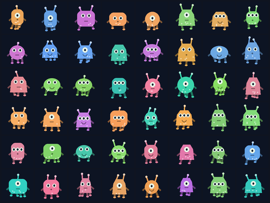
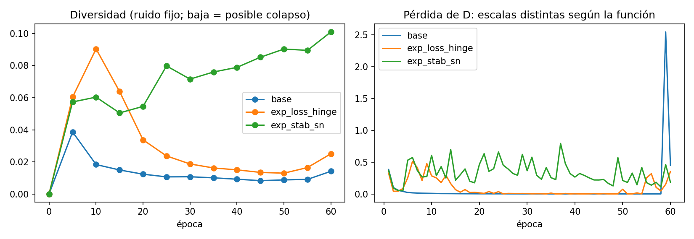
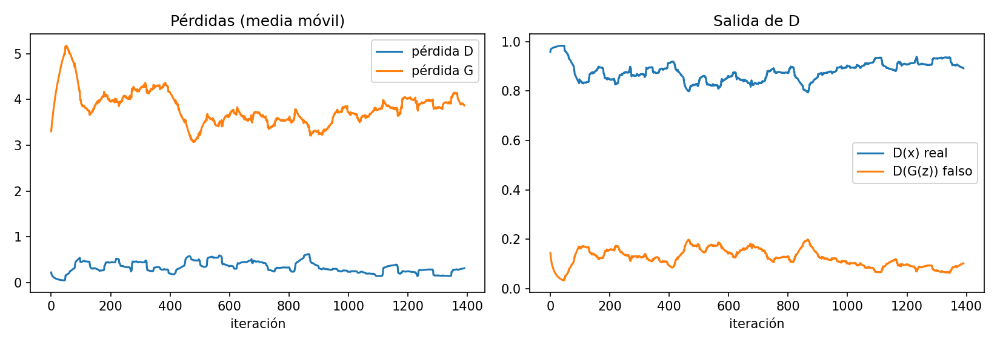
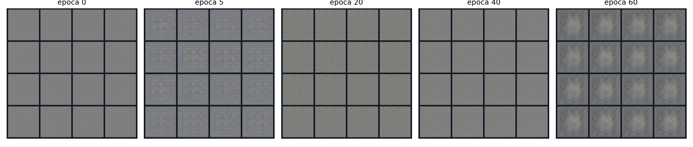
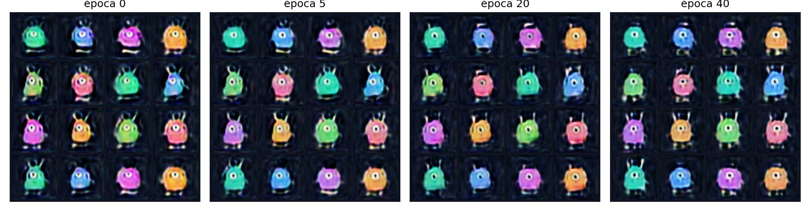
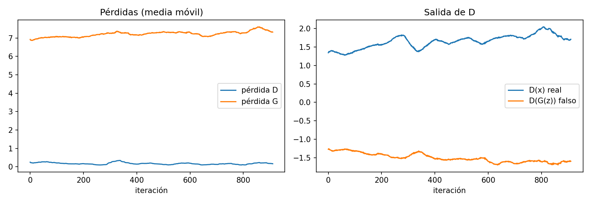
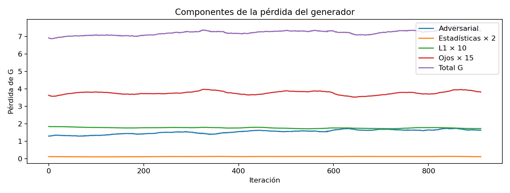
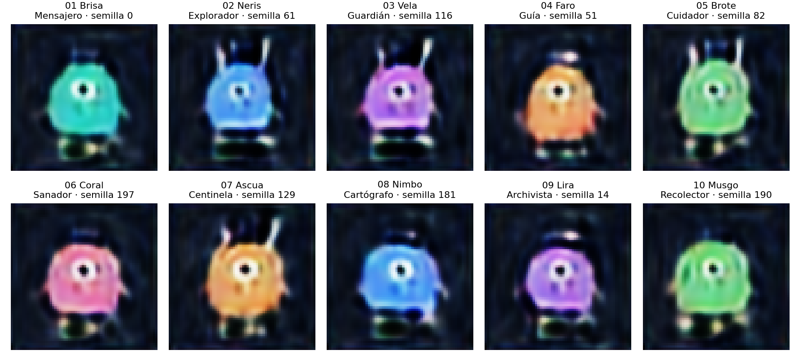
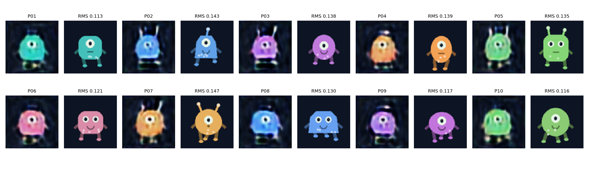

# Presentación: Luminarios del arrecife astral

Informe organizado en 12 diapositivas. Formato propuesto: 16:9, títulos de 32 puntos y texto principal de 18 puntos o más. Las figuras conservan la proporción original. Las tablas completas y el detalle de cada vecino se conservan en `resultados.md` y `nn_resultados/vecinos.csv` como material de apoyo.

## Diapositiva 1: Universo y objetivo

**Luminarios del arrecife astral**

Proyecto 2 · Deep Learning · Universidad del Valle de Guatemala · 11 de octubre de 2026

Se busca generar diez personajes distintos mediante una GAN y evaluar si reproducen imágenes de entrenamiento. El mundo está habitado por criaturas pequeñas y luminosas, con cuerpos redondos, ojos claros, antenas y patas cortas sobre un fondo oscuro. Se esperan diferencias visibles de forma y color.

## Diapositiva 2: Datos originales y preparación

Se construyeron 1,536 dibujos propios mediante figuras geométricas en Pillow. No se utilizaron fotografías ni personajes de terceros. Los dibujos de entrenamiento se producen con `build_dataset.py`; la galería se produce exclusivamente con la GAN.

- RGB, 64 × 64 píxeles; dibujo inicial a 128 × 128 y reducción Lanczos.
- Seis colores, tres cuerpos, uno a tres ojos y dos a cuatro patas.
- Semilla 20261011; recorte centrado y normalización a [-1, 1].
- Se conservaron 1,536 imágenes: 0 duplicados, 0 pequeñas y 0 ilegibles.
- Sin aumento de datos en las corridas controladas. El material se creó dentro del proyecto para entrenamiento y evaluación.

## Diapositiva 3: Arquitectura de la GAN

Se utiliza un vector gaussiano de 64 componentes y una salida RGB de 64 × 64. La base usa convoluciones transpuestas con tamaños 4, 8, 16, 32 y 64. Los canales de G son 128, 64, 32, 16 y 3; los de D son 16, 32, 64, 128 y 1. G utiliza BatchNorm y ReLU, con Tanh en la salida. D utiliza LeakyReLU, BatchNorm y logits sin sigmoide.

La base tiene 304,352 parámetros en G y 175,296 en D. Se eligió una arquitectura pequeña para permitir entrenamiento real en CPU. La variante final usa ampliación bilineal seguida de convoluciones 3 × 3, normalización espectral y ausencia de BatchNorm en D. Sus parámetros son 261,520 en G y 178,944 en D.

La variante final cambia varias condiciones y se analiza como una configuración completa. No sustituye las comparaciones controladas. La entrada final de G combina 64 componentes de ruido y 16 indicadores de color, ojos, cuerpo y antenas. D recibe tres canales RGB y 16 canales constantes de atributos. Los atributos se verifican contra las huellas de los dibujos originales. No se entrenan etiquetas de nombre o rol.

| Red base | Secuencia espacial | Función |
|---|---|---|
| G | z → 4 → 8 → 16 → 32 → 64 | Produce la imagen |
| D | 64 → 32 → 16 → 8 → 4 → 1 | Evalúa real frente a generada |

Fuente: Radford et al. (2015), https://arxiv.org/abs/1511.06434.

## Diapositiva 4: Protocolo de comparación

Se mantienen los mismos datos, 60 épocas, lote de 64, semilla 42, ruido fijo con semilla 1234 y 16 vectores de evaluación. Adam utiliza tasas 0.0002 para ambas redes y betas (0.5, 0.999). No se aplica aumento de datos. El orden de los lotes y el ruido de entrenamiento usan secuencias independientes con semillas 1042 y 2042.

El experimento hinge cambia únicamente la pérdida. El experimento espectral cambia únicamente la normalización espectral de D. Las hipótesis se conservan en el notebook y en `experimentos.md` desde antes de la ejecución. Se verifica que los conjuntos, los vectores fijos y las condiciones comunes coinciden.

| Corrida | Único cambio frente a la base |
|---|---|
| Base | BCE no saturante |
| Pérdida | BCE → hinge |
| Estabilización | Normalización espectral en D |

La variante final de 40 épocas se analiza aparte, porque cambia arquitectura, pérdida, normalización, condiciones y tasa de D.

## Diapositiva 5: Experimento de pérdida

**Hipótesis previa:** Se espera que la pérdida hinge mejorará la diversidad de los personajes porque utiliza un margen para el discriminador y una señal lineal para el generador. Se considerará útil si la diversidad RMS media de las últimas tres rejillas no cae más de 10 % frente a la base y la inspección del mismo ruido fijo muestra cuerpos y rasgos al menos igual de reconocibles, sin repetición dominante de una sola forma.

En BCE se utiliza `BCEWithLogits` para las etiquetas reales y falsas. G recibe la etiqueta real. En hinge, D utiliza márgenes alrededor de +1 y -1, y G minimiza `-mean(D(fake))`.

**Resultado:** La diversidad media de las últimas tres rejillas fue 0.0182, frente a 0.0108 de la base: una relación de 1.70. Se cumplió la condición numérica. Sin embargo, las muestras conservaron mucho ruido y una forma central repetida. La diversidad volvió a caer después de las primeras épocas. El criterio visual de la hipótesis no se cumplió de forma suficiente; hinge por sí sola no resolvió el problema.

Diversidad media final: base 0.0108; hinge 0.0182. Relación: 1.70.

Fuentes: Goodfellow et al. (2014), https://arxiv.org/abs/1406.2661; Zhang et al. (2018), https://arxiv.org/abs/1805.08318, ecuación 4 para hinge.

## Diapositiva 6: Experimento de estabilización

**Hipótesis previa:** Se espera que la normalización espectral mejorará la estabilidad porque limita la amplificación de las convoluciones del discriminador. Se considerará útil si la desviación de la pérdida de D durante las últimas 20 épocas es menor que en la base, la diversidad media de las últimas tres rejillas no cae más de 10 % y la inspección visual no muestra una pérdida clara de rasgos reconocibles.

La normalización espectral controla la amplificación de las convoluciones de D. Se mantienen BCE, BatchNorm y las demás condiciones. La presencia de BatchNorm impide interpretar la técnica como una garantía global sobre toda la red.

**Resultado:** La diversidad media final aumentó a 0.0936, una relación de 8.70 frente a la base. La desviación de D en las últimas 20 épocas fue 0.1174, frente a 0.5585 de la base. La diferencia también refleja el salto tardío de la base. Se observaron cuerpos de colores y antenas con más variedad que en las otras corridas controladas. La técnica resultó útil respecto a la base, aunque persistieron ruido y deformaciones y no se obtuvo una galería de calidad suficiente solo con ella.

Desviación de D en las últimas 20 épocas: base 0.5585; espectral 0.1174. Diversidad media final: espectral 0.0936.

Fuente: Miyato et al. (2018), https://arxiv.org/abs/1802.05957.

## Diapositiva 7: Evolución con ruido fijo

En las comparaciones controladas se guardaron los mismos 16 vectores de evaluación, con semilla 1234, y se generaron imágenes en diferentes épocas. En la variante condicional se conserva ese ruido y se añade una condición fija por posición. Las rejillas permiten seguir cambios de forma y detectar repetición.

La base produjo patrones de ruido y muestras muy parecidas. La pérdida de D permaneció cerca de cero durante muchas épocas y la de G aumentó. La diversidad cayó desde 0.0387 en la época 5 hasta 0.0089 en la época 50. En las épocas 59 y 60 ocurrió un salto en la pérdida de D, pero las imágenes finales siguieron siendo deficientes. La configuración no se utilizó para la galería. El ajuste de 40 épocas mejoró el contraste alrededor del ojo y conservó cuerpos, colores y antenas reconocibles. No resolvió de forma fiable la cantidad de ojos. La condición solicitada se registra aparte de los rasgos observados. Se seleccionaron diez conceptos de personaje con diferencias visibles, pero la familia de rostros y varias siluetas siguen siendo parecidas; no se afirma diversidad anatómica completa.

## Diapositiva 8: Curvas, desbalance y variante final

La base mostró un discriminador dominante, pérdidas de G crecientes y pérdida de variedad. Hinge no resolvió el ruido. La normalización espectral ayudó, pero fue insuficiente. La variante bilineal produjo curvas suaves con imágenes deficientes. Las estadísticas recuperaron el fondo y el color, aunque conservaron un ojo dominante. Las condiciones y el ajuste facial mejoraron ciertos rasgos sin garantizar los tres conteos de ojos. Estas observaciones muestran que una pérdida baja o una condición escrita no bastan para asegurar calidad o diversidad.

La variante `conditional_refined` se entrenó durante 40 épocas, con pérdida hinge, tasa G 0.0001, tasa D 0.0001, generador resize y normalización de D none. Su pérdida final fue D 0.1244, G 7.3083 y su diversidad RMS final fue 0.3946. El tiempo registrado fue 6.6 minutos. El ajuste de 40 épocas mejoró el contraste alrededor del ojo y conservó cuerpos, colores y antenas reconocibles. No resolvió de forma fiable la cantidad de ojos. La condición solicitada se registra aparte de los rasgos observados. Se seleccionaron diez conceptos de personaje con diferencias visibles, pero la familia de rostros y varias siluetas siguen siendo parecidas; no se afirma diversidad anatómica completa. Se agregó una regularización propia con peso 2 para comparar las medias y desviaciones de los lotes a 8 × 8. La pérdida total de G incluye ese término; la pérdida adversarial y la penalización se registran por separado en regularization.csv. También se agregó L1 con peso 10 frente a una imagen real de la misma condición. El ruido no identifica una imagen real; el término favorece un prototipo por atributos y puede reducir la variación dentro de cada condición. Ese término también se registra por separado. Se agregó un error cuadrático con peso 15 en la región de los ojos. El modelo parte de 80 épocas condicionales y se ajusta durante 40 más, para un total de 120. La etapa cero de su rejilla corresponde a los pesos de la fase anterior; no es una inicialización aleatoria. Los optimizadores se reinician y la ventana depende del encuadre fijo del conjunto. El tiempo de 6.6 minutos corresponde solo al ajuste; la fase inicial registró 12.6 minutos, para un total de 19.2 minutos en estas dos fases.

La regularización sobre medias y desviaciones es una adaptación propia en píxeles. La comparación de estadísticas se relaciona con Salimans et al. (2016), https://arxiv.org/abs/1606.03498; no se replica su método de características aprendidas.

La pérdida de D cercana a cero durante muchas épocas se interpreta como una señal de desbalance. La diversidad RMS también puede aumentar por ruido. Las curvas se leen junto con las imágenes; no se comparan pérdidas absolutas entre BCE y hinge.

## Diapositiva 9: Galería y tasa de selección

Se seleccionaron **10 de 600** candidatos. Criterio: Se priorizaron cuerpos reconocibles y una combinación de colores, siluetas y tipos de antena. Se revisaron los vecinos de entrenamiento. La selección mantiene una familia visual similar y predomina un ojo central; no se afirma una variedad anatómica completa..

La cantidad incluye 400 candidatos de variantes anteriores y 200 del checkpoint final. No se mezclan modelos dentro de la galería.

| Personaje | Nombre | Rol | Semilla | Rasgos observados |
|---|---|---|---:|---|
| 01 | Brisa | Mensajero | 0 | Cuerpo turquesa compacto, contorno redondo y antenas cortas. |
| 02 | Neris | Explorador | 61 | Cuerpo azul con base ancha y dos antenas largas. |
| 03 | Vela | Guardián | 116 | Cuerpo violeta ancho, antenas altas y borde inferior claro. |
| 04 | Faro | Guía | 51 | Cuerpo naranja, parte superior redonda y base amplia. |
| 05 | Brote | Cuidador | 82 | Cuerpo verde vertical, antenas largas y contorno ovalado. |
| 06 | Coral | Sanador | 197 | Cuerpo rosa con esquinas suaves y extremidades cortas. |
| 07 | Ascua | Centinela | 129 | Cuerpo naranja con dos antenas altas y silueta alargada. |
| 08 | Nimbo | Cartógrafo | 181 | Cuerpo azul compacto, antenas muy cortas y base casi plana. |
| 09 | Lira | Archivista | 14 | Cuerpo violeta bajo, marca clara superior y contorno redondo. |
| 10 | Musgo | Recolector | 190 | Cuerpo verde ovalado con zona superior lisa y extremidades cortas. |

Las semillas y los vectores completos se conservan en `galeria/seleccion.json`. Los roles se asignan después de generar las imágenes; no son etiquetas que la GAN haya aprendido.

## Diapositiva 10: Vecinos más cercanos

Se buscó el vecino exacto en píxeles entre las 1,536 imágenes de entrenamiento para cada personaje. La distancia RMS se calcula sobre RGB en [0, 1]. Una distancia menor indica mayor parecido. La mediana real frente a otra imagen real fue 0.1374; la mediana de los personajes frente al entrenamiento fue 0.1302. La distancia mínima al entrenamiento fue 0.1134. Se encontraron 0 copias exactas. La distancia mínima entre personajes seleccionados fue 0.1270. Estos valores no demuestran novedad semántica por sí solos. El fondo, el desenfoque y los defectos afectan la distancia.

La mediana de las distancias generadas fue 0.1302, algo menor que la mediana real de 0.1374. La mínima generada, 0.1134, estuvo por debajo del percentil 10 de la calibración real. El modelo produce variantes próximas a los prototipos del conjunto. No se encontraron copias exactas, pero esa ausencia no demuestra por sí sola que todos los conceptos sean nuevos. La comparación visual muestra diferencias de contorno, antenas y detalles, junto con una semejanza importante de familia.

Los archivos reales y las distancias por personaje se conservan en `nn_resultados/vecinos.csv`. La comparación de primer plano reduce la influencia del fondo, pero tampoco equivale a una evaluación semántica.

## Diapositiva 11: Conclusiones, límites y reflexión

Se obtuvo una galería regenerable y un proceso verificable de comparación de pérdidas, estabilización y ajustes posteriores. La normalización espectral mejoró la referencia y los términos auxiliares recuperaron cuerpos reconocibles. Persisten un rostro dominante y semejanza entre siluetas. El resultado permite estudiar lo aprendido por la GAN, pero no justifica afirmar que se resolvió de forma completa la variedad de personajes.

Se mantiene desenfoque, extremidades poco definidas y predominio de un solo tipo de rostro. Algunas muestras pueden considerarse variantes de una misma familia, por lo que el requisito de diez personajes claramente distintos requiere una valoración visual exigente. La novedad semántica no queda demostrada solo con píxeles. El conjunto es pequeño, centrado y de reglas simples; la pérdida de reconstrucción favorece prototipos por condición y el ajuste de ojos depende de una ventana fija.

**Reflexión final:** Brisa, personaje 01 y semilla 0, fue el caso más difícil de defender como nuevo. Su vecino 00179 comparte el color turquesa, el ojo central y un cuerpo compacto; su RMS fue 0.1134, el menor de la galería. Cambian el contorno, la boca y las extremidades, pero la diferencia de familia es pequeña. El caso indica que la GAN aprendió prototipos visuales del universo y que el ruido no garantiza un concepto nuevo. La evidencia de novedad se considera limitada y este caso se conserva como un límite del resultado.

Se utiliza una sola semilla por configuración y un conjunto de dibujos simples. No se afirma comprensión de roles, anatomía o narrativa. Una distancia alta puede deberse a desenfoque o defectos.

## Diapositiva 12: Matriz de evidencias

| Evidencia | Diapositiva | Conclusión | Limitación |
|---|---:|---|---|
| Universo y datos | 1–2 | Estilo propio y origen documentado | Dibujos de reglas simples |
| Arquitectura y control | 3–4 | GAN ejecutable; condiciones comunes verificables | Una sola semilla |
| Comparación de pérdida | 5 | El cambio se evalúa con curvas y muestras | BCE y hinge tienen escalas distintas |
| Estabilización | 6 | Se analiza la técnica de forma aislada | Curvas suaves no garantizan calidad |
| Ruido fijo | 7 | Evolución de los mismos 16 vectores | Muestra limitada de latentes |
| Curvas y fallos | 8, 11 | Se detectan desbalance y pérdida de variedad | Las pérdidas no miden utilidad visual |
| Galería y selección | 9 | Diez PNG regenerables; selección declarada | Calidad limitada y selección manual |
| Vecinos y reflexión | 10–11 | Se muestran los diez vecinos reales | Píxeles no prueban novedad semántica |

Las configuraciones, semillas, pesos, imágenes y registros se conservan para reproducir la galería y contrastar estas conclusiones.
